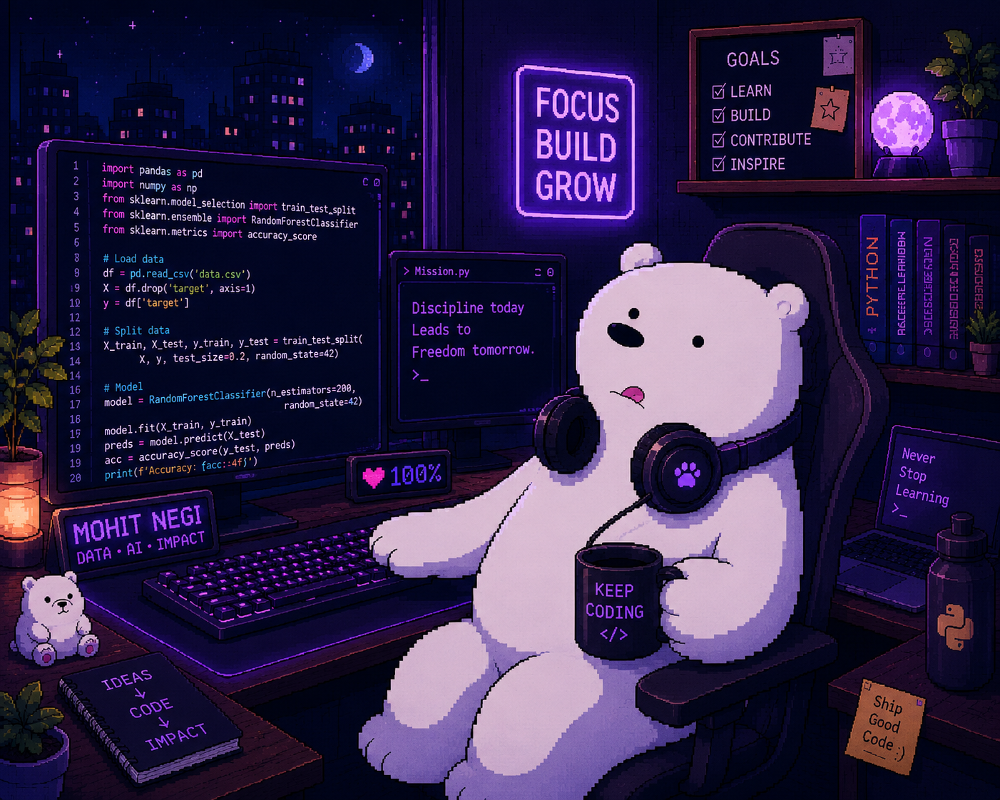

<p align="center">
  
</p>

<p align="center">
  
</p>

<!DOCTYPE html>
<html lang="en">
<head>
<meta charset="UTF-8">
<meta name="viewport" content="width=device-width, initial-scale=1.0">

<title>Mohit Negi - Data Science</title>

<style>
* {
    margin: 0;
    padding: 0;
    box-sizing: border-box;
}

body {
    background: #211b25;
    font-family: "Courier New", monospace;
}

.banner {
    width: 100%;
    min-height: 370px;
    background: #0c1117;
    border-top: 13px solid #211b25;

    display: flex;
    flex-direction: column;
    justify-content: center;
    align-items: center;

    text-align: center;
    padding: 40px 20px;

    position: relative;
    overflow: hidden;
}

.banner::before {
    content: "";
    position: absolute;
    inset: 0;
    background-image: radial-gradient(
        #ffffff12 0.7px,
        transparent 0.7px
    );
    background-size: 4px 4px;
    opacity: 0.4;
}

.line {
    position: relative;
    z-index: 1;
    color: #b026d3;
    font-weight: 400;
    line-height: 1.5;

    min-height: 1.5em;
    margin-bottom: 12px;
}

.line:nth-child(1) {
    font-size: clamp(22px, 4vw, 48px);
}

.line:nth-child(2) {
    font-size: clamp(17px, 3.5vw, 40px);
}

.line:nth-child(3),
.line:nth-child(4) {
    font-size: clamp(16px, 2.8vw, 34px);
}

.cursor::after {
    content: "|";
    color: #b026d3;
    animation: blink 0.7s steps(2) infinite;
}

@keyframes blink {
    50% { opacity: 0; }
}

.footer {
    width: 100%;
    height: 138px;
    background: linear-gradient(
        110deg,
        #211b25,
        #29182c
    );
}

@media (max-width: 600px) {
    .banner {
        min-height: 300px;
        padding: 35px 12px;
    }
}
</style>
</head>

<body>

<div class="banner">

    <h1 class="line"></h1>
    <h2 class="line"></h2>
    <p class="line"></p>
    <p class="line"></p>

</div>

<div class="footer"></div>

<script>
const lines = document.querySelectorAll(".line");

const messages = [
    "Turning Data into Insights & Intelligence",
    "Data Analysis | Data Science | Machine Learning",
    "Python | SQL | Excel | Power BI",
    "Exploratory Data Analysis | Data Visualization"
];

const typingSpeed = 65;
const lineDelay = 500;
const restartDelay = 2000;

let currentLine = 0;
let currentChar = 0;

function typeNextCharacter() {

    if (currentLine >= messages.length) {
        setTimeout(resetAnimation, restartDelay);
        return;
    }

    const element = lines[currentLine];
    const message = messages[currentLine];

    element.classList.add("cursor");

    if (currentChar < message.length) {

        element.textContent += message[currentChar];

        currentChar++;

        setTimeout(typeNextCharacter, typingSpeed);

    } else {

        element.classList.remove("cursor");

        currentLine++;
        currentChar = 0;

        setTimeout(typeNextCharacter, lineDelay);
    }
}

function resetAnimation() {

    lines.forEach(line => {
        line.textContent = "";
        line.classList.remove("cursor");
    });

    currentLine = 0;
    currentChar = 0;

    setTimeout(typeNextCharacter, 500);
}

// Start animation
typeNextCharacter();

</script>

</body>
</html>

---

<p align="center">
  
</p>

## About Me

```json
Mohit = {
    "focus"      : ["AI Agents", "LLMs", "Data Scientist", "Data Analytics"],
    "skills"     : ["Python", "SQL", "Power BI", "Machine Learning", "Deep Learning", "NLP"],
    "passionate" : ["AI-powered products", "Scalable systems", "Open Source"],
    "goal"       : "Combining data engineering with intelligent product development"
}
```
---

## Tech Stack

<h3 align="center">Languages</h3>

<p align="center">
  
  
</p>

<h3 align="center">Data Analytics & Visualization</h3>

<p align="center">
  
  
  
  
  
</p>

<h3 align="center">Databases</h3>

<p align="center">
  
</p>

<h3 align="center">Machine Learning</h3>

<p align="center">
  
  
  
  
</p>

<h3 align="center">Deep Learning & NLP</h3>

<p align="center">
  
  
  
  
</p>

---

## Connect With Me

<p align="center">
  <a href="https://github.com/Mohit24Negi"></a>
  <a href="https://www.linkedin.com/in/mohit-negi-8abb82396/"></a>
  <a href="https://www.kaggle.com/salamanbhai"></a>
</p>

<p align="center">
  
</p>
